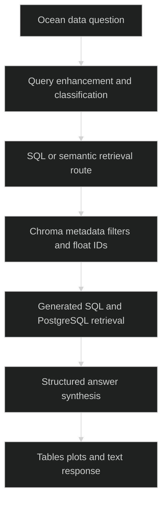

# Anantha

> `Natural-language ocean-data queries routed through semantic retrieval and PostgreSQL.`

### 🏗️ System Architecture



### 🛠️ Production Stack

Python · FastAPI · ChromaDB · PostgreSQL · provider LLM calls · pandas · React · Vite

### ⚡ Key Engineering Capabilities

- Intent classification selects structured or semantic retrieval paths.
- Vector results constrain downstream structured data queries.
- Response handling supports narrative, tabular and plot-oriented output.

### 🚀 Deployment and Local Setup

Run from the repository root after cloning:

```bash
git clone https://github.com/ryash14/Anantha.git
cd Anantha
python3 -m venv .venv
source .venv/bin/activate
python -m pip install -r backend/requirements.txt
cd backend
python -m uvicorn main:app --host 127.0.0.1 --port 8000
# In another terminal at the repository root: npm install && npm run dev
```

Configure PostgreSQL, source data, Chroma indexes and provider credentials before querying. Inspect the backend database and embedding modules for expected local paths and configuration. The code routes through Python functions; LangGraph and LSTM deployment are not asserted here. Generated SQL requires a restricted database role and validation before exposure to untrusted users.

### Source Map

- [backend/main.py](backend/main.py)
- [backend/main_pipeline.py](backend/main_pipeline.py)
- [backend/store_in_vector_db/vector_db.py](backend/store_in_vector_db/vector_db.py)
- [backend/retrieve_data_from_db/postgres_db.py](backend/retrieve_data_from_db/postgres_db.py)
