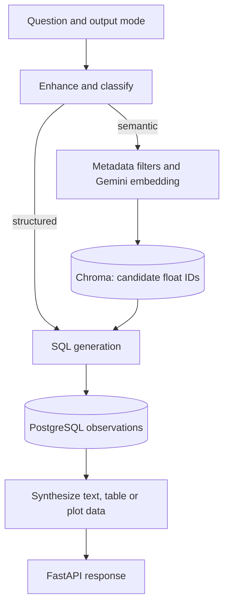

# Anantha

Anantha answers ocean-data questions by combining natural-language routing, semantic retrieval and PostgreSQL queries.

Oceanographic records often require both conceptual discovery and exact filtering. Anantha uses vector retrieval to identify relevant float records when a question is semantic, then retrieves structured observations through SQL. The response layer can produce text, tables and plot data from those results.

[Quick start](#quick-start) · [How it works](#how-it-works) · [Development](#development) · [Contributing](CONTRIBUTING.md)

## Quick start

Provision PostgreSQL, source observations, a populated Chroma collection and provider credentials. The vector module currently uses an absolute local Chroma path and reads `GEMINI_API_KEY2`; replace the path for your environment before launching.

From a fresh checkout:

```bash
git clone https://github.com/ryash14/Anantha.git
cd Anantha
python3 -m venv .venv
source .venv/bin/activate
python -m pip install -r backend/requirements.txt
cd backend
python -m uvicorn main:app --host 127.0.0.1 --port 8000
# In another terminal at the repository root: npm install && npm run dev
```

Configure PostgreSQL, source data, Chroma indexes and provider credentials before querying. Inspect the backend database and embedding modules for expected local paths and configuration. The code routes through Python functions; LangGraph and LSTM deployment are not asserted here. Generated SQL requires a restricted database role and validation before exposure to untrusted users.

## Data and provider setup

Before testing `/query`, inspect these integration points:

| Component | Setup responsibility |
|---|---|
| `backend/store_in_vector_db/vector_db.py` | Replace the machine-specific Chroma path and populate the `documents` collection |
| `GEMINI_API_KEY2` | Configure the key read by the embedding module |
| PostgreSQL retrieval module | Match connection settings and schema to the observation data |
| Query-generation modules | Configure their provider access and validate generated SQL |
| Browser API helper | Point the client at this backend and allow its origin |

Use a database role restricted to the intended reads. A successful LLM response is not sufficient evidence that a generated SQL statement is safe or that its oceanographic interpretation is correct.

## How it works

1. Submit a question and response mode to the FastAPI `/query` endpoint.
2. Query enhancement and classification choose a direct SQL path or a vector-assisted path.
3. Semantic retrieval applies metadata filters and supplies float IDs to SQL generation.
4. PostgreSQL results are converted into the requested answer or data presentation.

### Component boundaries



### Design decisions

The orchestrator is ordinary Python routing rather than a LangGraph state machine. Chroma holds semantic document records; PostgreSQL holds structured measurements. Gemini provides embedding and generation calls in the inspected modules.

The repository reflects a research/hackathon implementation: local data paths, database setup and model-provider configuration require adaptation. Forecasting or LSTM production behavior is not established by the request path documented here.

## Implementation

**Stack:** Python · FastAPI · ChromaDB · PostgreSQL · provider LLM calls · pandas · React · Vite.

- [backend/main.py](backend/main.py)
- [backend/main_pipeline.py](backend/main_pipeline.py)
- [backend/store_in_vector_db/vector_db.py](backend/store_in_vector_db/vector_db.py)
- [backend/retrieve_data_from_db/postgres_db.py](backend/retrieve_data_from_db/postgres_db.py)

## Development

There is no complete automated verification command documented for this application. Start the affected component, use a small synthetic input and inspect its output before changing integrations. The contribution guide describes the evidence expected in a pull request.

## Contributing and support

Report reproducible bugs or propose changes through [GitHub Issues](https://github.com/ryash14/Anantha/issues). Include the relevant environment and a small example rather than private datasets or credentials. See [contributing](CONTRIBUTING.md), [security reporting](SECURITY.md) and the [code of conduct](CODE_OF_CONDUCT.md).

## License

No repository-wide license is currently provided. Third-party components, models and datasets retain their own terms.
